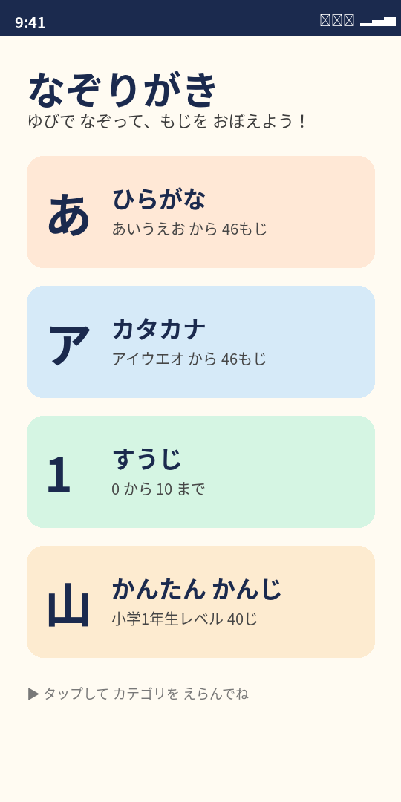
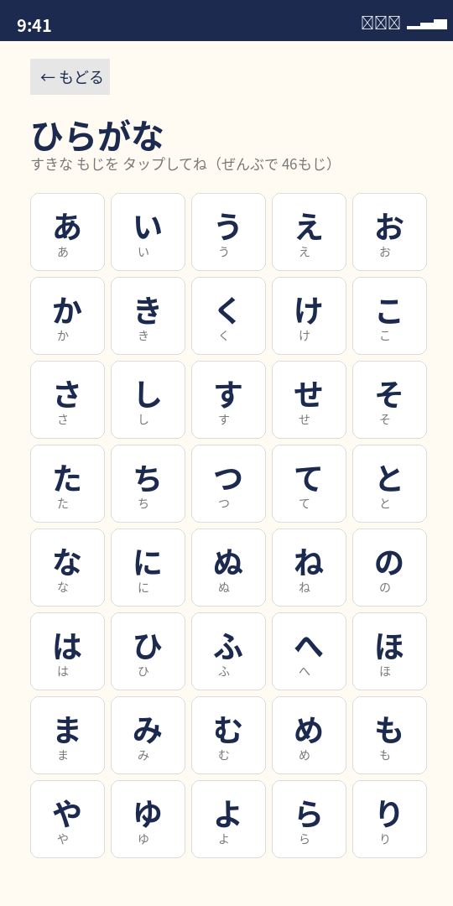
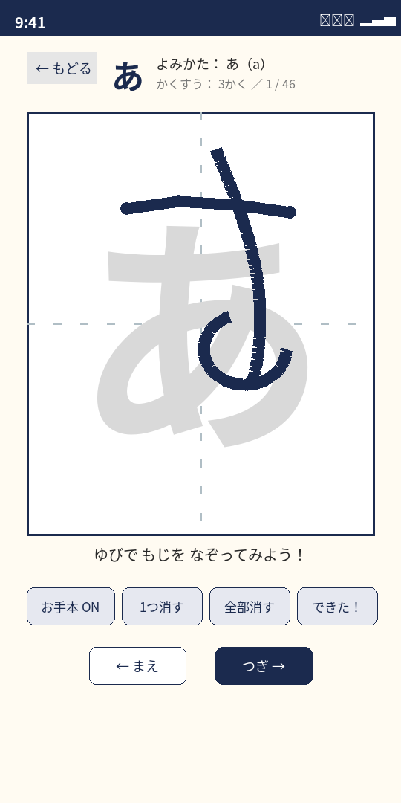
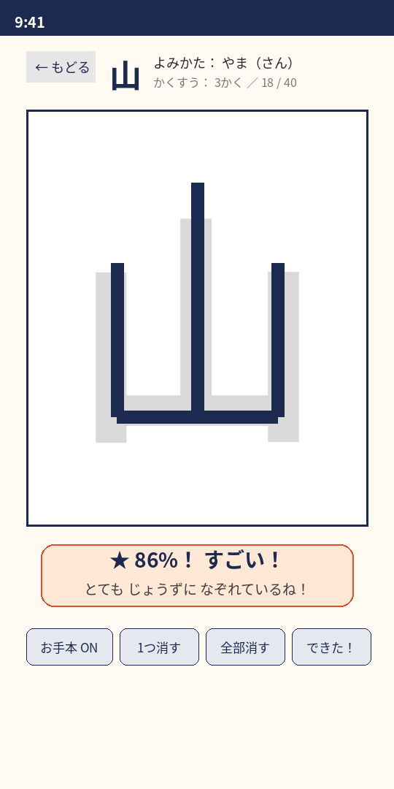
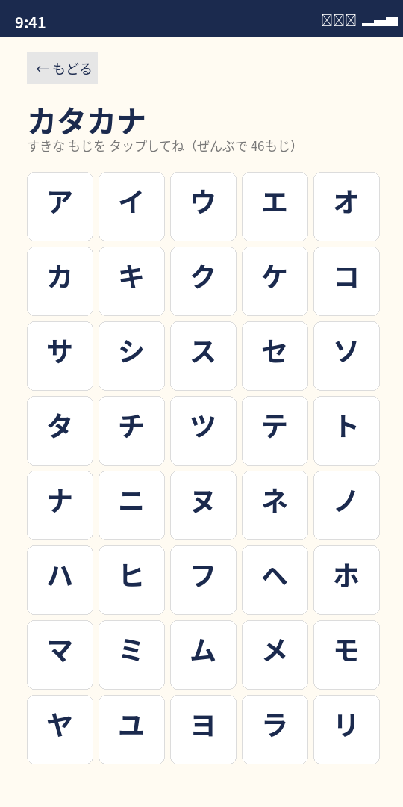

# なぞりがき (Nazorigaki)

指でなぞって遊びながら文字を覚える、子ども向け Android アプリです。
ひらがな・カタカナ・数字・簡単な漢字を、薄いお手本の上からなぞって練習できます。

- パッケージ: `jp.talus.nazorigaki`
- 言語: Kotlin / Android Views（ViewBinding）
- minSdk 24（Android 7.0） / targetSdk 34
- 外部通信なし・広告なし・課金なし（オフラインで完結）

## スクリーンショット

| ホーム（カテゴリ選択） | 文字一覧（ひらがな） |
|---|---|
|  |  |

| なぞり画面（「あ」を練習中） | 採点結果（漢字「山」86%） |
|---|---|
|  |  |

| 文字一覧（カタカナ） |
|---|
|  |

> スクリーンショットはアプリの画面構成をもとに作成したモック画像です。実機では同じレイアウト・配色で表示されます。

## どんなアプリ？

### 1. カテゴリを選ぶ（ホーム）
大きなカードをタップするだけ。子どもでも迷わない4カテゴリ構成です。

- **ひらがな** — 46文字
- **カタカナ** — 46文字
- **すうじ** — 0〜10（11文字）
- **かんたん かんじ** — 小学1年生配当中心の40字（一〜十、日月火水木金土、山川田、雨空花林、人・口・目・耳・手・足など）

収録は合計 **143文字**。各文字に「読み方・ローマ字/意味・画数」を持っています。

### 2. 文字を選ぶ（一覧）
5列グリッドで五十音順に並びます。タップすると練習画面へ。

### 3. なぞる（練習画面）
- 中央に **薄いグレーのお手本文字** ＋ **田の字ガイド**（点線の十字）で、文字のバランスが分かりやすい
- 指でなぞると **濃い紺色の太い線** が描かれます（`TraceView` がタッチ軌跡を `Path` で描画）
- **お手本 ON/OFF**：慣れてきたらお手本を消して挑戦できます
- **1つ消す / 全部消す**：書き直しはいつでもOK
- **まえ / つぎ**：一覧に戻らず次の文字へ進めます
- ヘッダーに読み方と画数（例：あ ／ よみかた：あ(a) ／ 3かく）を表示

### 4. 採点（「できた！」ボタン）
お手本文字をオフスクリーンBitmapに描いてピクセルをサンプリングし、
指の軌跡がお手本のどれだけをカバーしたかを **なぞり率（%）** として計算します。

- 80%以上：🌸 すごい！とてもじょうず！
- 55%以上：⭐ よくなぞれているね！
- 30%以上：👍 もう少しゆっくりなぞろう
- それ未満：お手本の上をゆっくりなぞってみよう、と励まします（×は出しません）

## 技術的な仕組み

```
app/src/main/java/jp/talus/nazorigaki/
├── MainActivity.kt          # ホーム（カテゴリ選択）
├── ListActivity.kt          # 文字一覧（GridView + BaseAdapter）
├── TraceActivity.kt         # 練習画面（採点・前後移動）
├── data/
│   └── CharacterData.kt     # 全143文字のデータ（文字・読み・ローマ字・画数）
└── view/
    └── TraceView.kt         # なぞり描画と採点のコア
        ├── onTouchEvent で Path を蓄積して描画
        ├── 田の字ガイドを DashPathEffect で描画
        └── rebuildGuide() でお手本Bitmapからサンプル点を生成し、
            軌跡との距離（38px以内）でカバー判定 → coveragePercent()
```

## ビルド方法

Android Studio でこのフォルダを開くか、コマンドラインで：

```bash
# JDK 17 が必要です
./gradlew assembleDebug
# → app/build/outputs/apk/debug/app-debug.apk
```

Gradle Wrapper の jar が含まれていない場合は、Android Studio が自動で取得します
（または `gradle wrapper --gradle-version 8.7` を一度実行してください）。

## 今後のアイデア

- 書き順アニメーション（数字で順番を表示 → 矢印アニメ）
- 濁点・半濁点（が・ざ・だ・ぱ行）と拗音（きゃ・しゅ・ちょ）
- できた文字にスタンプが貯まる「がんばりカード」
- 音声読み上げ（TextToSpeech）で読み方を聞けるようにする
- 小学2年生漢字の追加

## ライセンス

MIT
